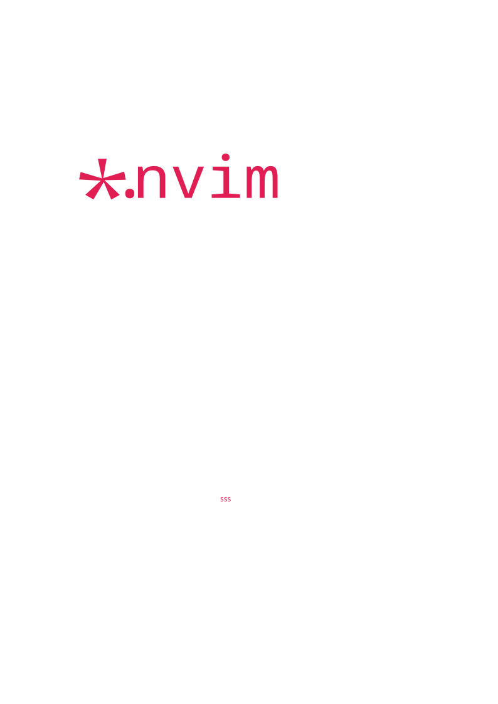
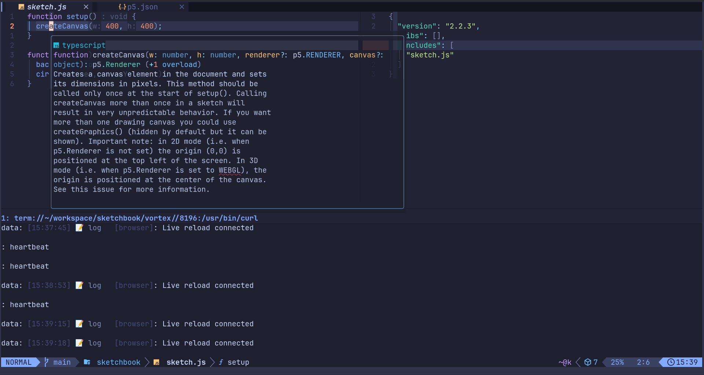

# `p5.nvim` 🌸

> Better editor support for p5.js sketchspaces in Neovim.

[](https://github.com/prjctimg/p5.nvim/releases/latest)
[](https://github.com/prjctimg/p5.nvim/actions/workflows/release.yml)
---

## On this page

- [Features ✨](#features)
- [Requirements 📋](#requirements)
- [Installation 💾](#installation-💾)
- [What's a sketchspace ?](#whats-a-sketchspace)
- [Quick Start 🚀](#quick-start-🚀)
- [Commands 📖](#commands-📖)
- [Configuration ⚡](#configuration)
- [Auto Commands 🔌](#auto-commands-🔌)
- [Keyboard Shortcuts ⌨️](#keyboard-shortcuts-️)
- [Troubleshooting 🔧](#troubleshooting-🔧)
- [Doc Generation 📚](#doc-generation)
- [License 📜](#license-📜)

---

## Features ✨

- **Live Server** 🚀 - Auto-reload preview in browser
- **Package Management** 📦 - Install contributor libraries
- **Sketchspace** 📁 - Minimal project setup
- **GitHub Gist** 🔗 - Share sketches (synced to sketchspace)
- **CDP debug panel** 🛠️ - Chrome DevTools Protocol-backed panel for sketches: Console logs, Network requests, JS eval, Debugger (breakpoints/stepping/scopes), runtime Stats, and project Info
- **Console** 📺 - View browser logs in Neovim (deprecated — use CDP panel)
- **p5.js Docs** 📖 - Built-in reference via snacks.picker
- **Snippets** ✂️ - 100+ p5.js code snippets (VS Code JSON format, compatible with luasnip, blink.cmp, nvim-cmp)

---

## Requirements 📋

- `nvim` >= 0.11.0
- Rust toolchain (`cargo`) to build the bundled dev server, or a prebuilt `p5d` binary in the plugin root / on your `PATH`
- `curl` (used by CDP panel / console streaming integration)

---

## Installation 💾

```lua
-- lazy.nvim (installs latest release)
{
  "prjctimg/p5.nvim",
  dependencies = {
    "nvim-lua/plenary.nvim",
  },
  build = "cd srv && cargo build --release && cp target/release/p5d ../p5d && mkdir -p ~/.local/bin && cp target/release/p5d ~/.local/bin/p5d",
  config = function()
    require("p5").setup({})
  end
}
```

> Build once after install/update so `:P5 server` can find the `p5d` daemon. The plugin looks for `p5d` in the plugin root, `srv/target/{release,debug}/p5d`, and on your `PATH`. The build step above installs `p5d` to `~/.local/bin` (ensure it is in your `PATH`) and also copies it into the plugin root. Prebuilt binaries for the release matrix (excluding Termux/Android) are available on the [GitHub Releases](https://github.com/prjctimg/p5.nvim/releases) page.

---

## What's a sketchspace ?

A directory that has a `p5.json` file is called a `sketchspace`. The file looks like this:

```json
{
  "version": "2.0.0",
  "libs": {},
  "includes": ["sketch.js"],
  "gist": {
    "url": "username/gistId",
    "title": "My Sketch"
  }
}
```

- `version`: p5.js version to use
- `libs`: Object with library names as keys and their versions as values
- `includes`: Files to include in the Gist (default: `["sketch.js"]`)
- `gist`: Gist metadata object (optional) with `url` (`"user/gistId"`) and `title`

> [!important]
>
> This file is needed for setting up and running `sketchspaces`.
>
> It currently only works with this plugin.

---

## Quick Start 🚀

```vim
:P5 create my-sketch
:P5 server
:P5 cdp
```

---

## Commands 📖

### :P5 (interactive menu)

Open an interactive menu with all available commands. This is the default when
`:P5` is called without arguments.

```vim
:P5              # Open interactive menu
```

The menu shows context-aware labels (e.g. "Stop server" when the server is
running vs "Start server" when it's not).

---

### :P5 create [name]

Create a new sketchspace. Scaffold + `sketch.js` open immediately; p5.js downloads in
the background from cache/CDN. You are prompted for **global** vs **instance** mode
unless `sketch.mode` is set in setup. If a newer p5.js exists online, you are prompted
to upgrade (create/setup only). Offline uses the versioned cache when available.

```vim
:P5 create my-sketch
:P5 create
```

Type definitions ship with the plugin (`assets/types/`, produced by
[automata](https://github.com/prjctimg/automata)) and are copied into the sketchspace.
The generated `tsconfig.json` enables `checkJs`. Create `.ts` files alongside `.js`
for full TypeScript support. Refresh types by updating the plugin.

---

### :P5 setup

Setup assets in current sketchspace.

Downloads files from gist (if configured), creates default sketch.js if missing, copies assets, generates libs.js, and installs configured libraries.

```vim
:P5 setup
```

---

### :P5 install [libs...]

Install contributor libraries. Use picker or specify directly.

```vim
:P5 install ml5
:P5 install ml5 rita p5play
:P5 install
```

### :P5 uninstall [libs...]

Remove installed libraries.

```vim
:P5 uninstall ml5
:P5 uninstall
```

---

### :P5 server [port]

Start/stop the development server (toggle). Opens browser automatically and enables live reload.

```vim
:P5 server
:P5 server 8080
```

---

### :P5 cdp [subcommand]

Open a Chrome DevTools Protocol (CDP) debug panel for your p5.js sketch with 6 tabs.
It is a lightweight in-editor view (not a full Chrome DevTools UI).

| Tab | Key | What it shows |
|-----|-----|---------------|
| Console | `1` | Browser console logs/errors and exception stack traces (with basic level filter/search) |
| Network | `2` | Request log: method, status, time, type/MIME/size (when available), URL, and load errors |
| Eval | `3` | Evaluate JS expressions in the page context (or current call frame while paused) |
| Debug | `4` | Breakpoints (set/remove), pause/continue/step, call stack, and scope/`this` values when paused |
| Stats | `5` | Runtime metrics sampled from CDP `Performance.metrics` (FPS delta, JS heap, DOM nodes, listeners) |
| Info | `6` | Project info, live canvas state (via eval), and LSP document symbols for the current buffer |

```vim
:P5 cdp                # Toggle CDP panel
:P5 cdp connect        # Connect to Chrome debugger
:P5 cdp disconnect     # Disconnect
:P5 cdp status         # Show connection status
:P5 cdp eval <expr>    # Evaluate JS expression
:P5 cdp break <loc>    # Set breakpoint (e.g., sketch.js:12)
:P5 cdp continue       # Resume execution
:P5 cdp pause          # Pause execution
:P5 cdp pauseExceptions [none|uncaught|all]  # Pause on exceptions
:P5 cdp reload         # Reload the page
:P5 cdp screenshot [path]  # Save a screenshot of the page
:P5 cdp step           # Step over
:P5 cdp stepIn         # Step into
:P5 cdp stepOut        # Step out
:P5 cdp stats          # Open Stats tab
:P5 cdp network_clear  # Clear the network log
```

**CDP panel keymaps** (context-aware per tab, HUD only — set
`cdp.keymaps = false` to disable):

| Key | Console | Network | Eval | Debug | Stats | Info |
|-----|---------|---------|------|-------|-------|------|
| `1`-`6` | Switch tab | Switch tab | Switch tab | Switch tab | Switch tab | Switch tab |
| `q`/`<Esc>` | Close | Close | Close | Close | Close | Close |
| `c` | Clear | Clear | Clear | Clear | Clear | — |
| `r` | Refresh | Refresh | — | — | Toggle sampling | Refresh LSP |
| `<CR>` | — | — | Enter expr | Set BP | — | Jump to sym |
| `f` | Filter | — | — | — | — | — |
| `/` | Search | Search | — | — | — | — |
| `p` | — | — | — | Pause | — | — |
| `P` | — | — | — | Pause on exc. | — | — |
| `s` | — | — | — | Step over | — | — |
| `i` | — | — | — | Step into | — | — |
| `o` | — | — | — | Step out | — | — |
| `x` | — | — | — | Continue | — | — |
| `b` | — | — | — | Set breakpoint | — | — |
| `d` | — | — | — | Remove breakpoint | — | — |
| `D` | — | Clear all | — | — | — | — |
| `R` | Reload | Reload | Reload | Reload | Reload | Reload |
| `S` | Screenshot | Screenshot | Screenshot | Screenshot | Screenshot | Screenshot |
| `K`/`J` | — | — | — | — | — | Nav symbols |
| `g`/`G` | Top/Bot | Top/Bot | Top/Bot | Top/Bot | Top/Bot | Top/Bot |

**Keyboard shortcuts** example:

```lua
vim.keymap.set("n", "<leader>pd", ":P5 cdp<CR>", { desc = "Toggle CDP debug panel" })
```

**Browser flags:** When CDP is enabled, Chrome launches with graphics-debugging flags:
`--enable-gpu-rasterization`, `--disable-frame-rate-limit`, `--enable-precise-memory-info`,
and more. Configure via `setup({ cdp = { browser_flags = { ... } } })`.

**Isolation:** The CDP Chrome instance always runs with its own temp
`--user-data-dir` (cleaned up on close when `cdp.close_browser_on_close = true`), so
the debugging port is bound even when a regular Chrome/Chromium is already running.

**Troubleshooting — port not exposed:** If you launched Chrome manually with
`--remote-debugging-port` and nothing appears on that port, a pre-existing Chrome
instance likely ignored the flag. Quit all Chrome processes, or let p5.nvim launch
its own isolated instance (the default).

**Notes:** Breakpoints resolve against served script URLs, evaluation runs on the
current call frame while paused, `screenshot` saves a PNG, and reload bypasses the
cache. The panel targets the page served from the dev server origin when connecting.
Stats are sampled runtime metrics (not a Chrome Performance trace/profiler).

---

### :P5 gist [desc|sync|edit]

Create, sync, or edit a GitHub Gist from your sketchspace.

```vim
:P5 gist "My awesome sketch"     # Create gist with title
:P5 gist                         # Prompt for title then create
:P5 gist sync                    # Bidirectional sync (title, description, files)
:P5 gist edit                    # Edit gist title or first comment
```

On creation, stores `gist` as an object in `p5.json` with `url` and `title`
(from the gist's description).

When syncing, compares remote vs local state and prompts per difference:
title (the gist description) and each source file. Files existing on
only one side are auto-accepted.

Use `:P5 gist edit` to change the title or first comment — changes sync
both to the remote gist and the local `p5.json`.

---

### :P5 update [libs...]

Update all installed libraries or specific ones.

```vim
:P5 update                       # Update all installed addons
:P5 update ml5 p5play            # Update specific libraries
```

---

### :P5 skchbk [list]

Clone all gists from a GitHub user into a local `skchbk/` directory. Each gist is saved in its own subdirectory named after the gist description.

Requires a [dedicated GitHub account](https://docs.github.com/en/gists) whose gists are all valid p5.js sketches.

```vim
:P5 skchbk                # Clone all gists from configured user
:P5 skchbk list           # Browse local sketches or browse/list remotely
```

If `skchbk/` doesn't exist or is empty, `:P5 skchbk list` prompts you to clone all gists or browse them remotely and clone individual ones.

The `skchbk/` directory is automatically excluded from gist uploads.

---

### :P5 list

Open a picker of recently used sketchspaces and change directory to the
selected one.

```vim
:P5 list
```

---

### :P5 docs

Open p5.js documentation via snacks.picker.

```vim
:P5 docs
```

---

## Snippets ✂️

p5.nvim ships with 100+ p5.js code snippets in VS Code JSON format. All snippets use a `p5-` prefix to avoid conflicts with other snippet packs.

### Installation

Snippets are auto-discovered from runtimepath. Just add a snippet loader:

**LuaSnip:**

```lua
require("luasnip.loaders.from_vscode").lazy_load()
```

**blink.cmp (default preset):** Auto-discovered, zero configuration.

**blink.cmp (luasnip preset):**

```lua
-- Already using luasnip? snippets are auto-discovered via luasnip
sources = {
  default = { "lsp", "path", "snippets", "buffer" },
}
```

**nvim-cmp:**

```lua
cmp.setup({
  snippet = {
    expand = function(args)
      require("luasnip").lsp_expand(args.body)
    end,
  },
  sources = {
    { name = "luasnip" },
  },
})
```

### Trigger Convention

Type `p5-` followed by the snippet name in a `.js` file to trigger:

| Category | Example Trigger | Expands To |
|----------|----------------|------------|
| Lifecycle | `p5-sketch`, `p5-setup`, `p5-draw`, `p5-preload` | Full sketch skeleton or function |
| Paired constructs | `p5-push`, `p5-beginshape`, `p5-loadpixels`, `p5-creategraphics` | Block with open/close calls |
| Vertex calls | `p5-vertex`, `p5-curvevertex`, `p5-beziervertex` | Single vertex() inside shape |
| Basic shapes | `p5-canvas`, `p5-circle`, `p5-rect`, `p5-line` | Common 2D primitives |
| Color & style | `p5-fill`, `p5-stroke`, `p5-nofill`, `p5-colormode-hsb` | Color and attribute setters |
| Transformations | `p5-translate`, `p5-rotate`, `p5-scale` | Coordinate transforms |
| Math & vector | `p5-map`, `p5-constrain`, `p5-random`, `p5-vector` | Math utilities |
| Typography | `p5-text`, `p5-textsize`, `p5-loadfont`, `p5-textalign` | Text rendering |
| Images | `p5-loadimage`, `p5-pixels`, `p5-tint`, `p5-filter` | Image loading and processing |
| Events | `p5-mousepressed`, `p5-keypressed`, `p5-mousedragged` | Input event handlers |
| 3D / WebGL | `p5-box`, `p5-sphere`, `p5-orbitcontrol`, `p5-texture` | 3D primitives and lights |
| DOM | `p5-createslider`, `p5-createbutton`, `p5-createselect` | UI elements |
| Sound | `p5-loadsound`, `p5-fft`, `p5-oscillator` | Audio playback and analysis |
| IO | `p5-loadjson`, `p5-loadstrings`, `p5-savecanvas` | Data loading and saving |
| Common idioms | `p5-forgrid`, `p5-forpolar`, `p5-particles`, `p5-bounce` | Multi-line patterns |

### Example

Typing `p5-sketch` and expanding gives:

```javascript
function setup() {
  createCanvas(400, 400);
}

function draw() {
  background(220);
}
```

Typing `p5-beginshape` and expanding gives:

```javascript
beginShape();
  vertex(x, y)
endShape(CLOSE);
```

All tab stops (`$1`, `$2`, etc.) are navigable; press `<Tab>` to jump between
them (requires luasnip or blink.cmp luasnip preset).

---

## Configuration ⚡

```lua
require("p5").setup({
  -- Server settings
  server = {
    port = 8000,                    -- Server port
    auto_open_browser = true,      -- Open browser automatically

    -- Live reload settings
    live_reload = {
      enabled = true,               -- Enable live reload
      port = 12002,                -- Live reload port
      debounce_ms = 300,           -- Debounce delay
      watch_extensions = {".js", ".css", ".html", ".json"},  -- Files to watch
      exclude_dirs = {".git", "node_modules", "dist", "build"}  -- Exclude directories
    }
  },

  -- Default sketch template mode: nil = prompt on :P5 create
  sketch = {
    mode = nil,                    -- "global" | "instance" | nil
  },

  -- Runtime p5.js version defaults
  p5 = {
    version = nil,                 -- pin default for new projects (nil = plugin default/cache)
    check_update = true,           -- prompt on create/setup when a newer version exists
  },

  -- Library settings
  libraries = {
    auto_update = false            -- Auto update libraries on setup
  },

  -- Sketchbook settings
  sketchbook = {
    user = ""                      -- GitHub username whose gists form the sketchbook
  },

  -- CDP debug panel settings
  cdp = {
    enabled = false,               -- Enable CDP (auto-enabled when panel opens)
    remote_debugging_port = 9222,  -- Chrome remote debugging port
    keymaps = true,                -- HUD keymaps (1-6 tabs, p/P/R/S, ...); false to disable
    close_browser_on_close = true, -- Kill the CDP Chrome instance and remove its temp profile on close
    browser_flags = {              -- Extra Chrome flags for graphics debugging
      "--enable-gpu-rasterization",
      "--disable-frame-rate-limit",
      "--disable-gpu-driver-bug-workarounds",
      "--enable-precise-memory-info",
      "--disable-software-rasterizer",
    },
  },

  view = {
    position = "below",
    height = 10,
  },
})
```

---

## Auto Commands 🔌

Toggle built-in autocmds via config to avoid boilerplate:

```lua
require("p5").setup({
  autocmds = {
    server_on_enter = false,      -- Auto-start server when opening sketch.js
    cdp_on_server_start = false,  -- Open CDP panel when server starts
    save_on_focus_lost = false,   -- Auto-save *.js on focus loss (triggers live reload)
    refresh_on_save = false,      -- Refresh CDP info tab when sketch.js is saved
    close_cdp_on_stop = true,     -- Close CDP panel when server stops
    reset_on_dir_change = false,  -- Reset CDP connection when changing directories
  },
})
```

Or, create your own:

```lua
-- Auto-start server when opening sketch.js
vim.api.nvim_create_autocmd({ "BufEnter" }, {
  pattern = "sketch.js",
  callback = function() vim.cmd("P5 server") end,
})

-- Auto-open CDP panel when server starts
vim.api.nvim_create_autocmd({ "User", "P5ServerStarted" }, {
  callback = function() vim.cmd("P5 cdp") end,
})
```

---

## Keyboard Shortcuts ⌨️

Example keybindings using `<leader>p` prefix:

```lua
-- General
vim.keymap.set("n", "<leader>p5", ":P5<CR>", { desc = "Open p5.nvim picker" })

-- Project
vim.keymap.set("n", "<leader>pc", ":P5 create ", { desc = "Create project" })
vim.keymap.set("n", "<leader>ps", ":P5 setup<CR>", { desc = "Setup project" })

-- Server
vim.keymap.set("n", "<leader>pss", ":P5 server<CR>", { desc = "Toggle server" })
vim.keymap.set("n", "<leader>psd", ":P5 cdp<CR>", { desc = "Toggle CDP debug panel" })

-- Libraries
vim.keymap.set("n", "<leader>pi", ":P5 install ", { desc = "Install library" })
vim.keymap.set("n", "<leader>pu", ":P5 uninstall ", { desc = "Uninstall library" })
vim.keymap.set("n", "<leader>pU", ":P5 update<CR>", { desc = "Update libraries" })

-- Gist
vim.keymap.set("n", "<leader>pg", ":P5 gist ", { desc = "Create gist" })
vim.keymap.set("n", "<leader>pgg", ":P5 gist sync<CR>", { desc = "Sync gist" })

-- Docs
vim.keymap.set("n", "<leader>pd", ":P5 docs<CR>", { desc = "Open p5.js docs" })
```

---

## Troubleshooting 🔧

### Server Won't Start

**Symptoms:** Running `:P5 server` shows an error or nothing happens.

**Solutions:**

1. Build the dev server binary:

   ```bash
   cd srv && cargo build --release
   ```

2. Check if the port is already in use:

   ```bash
   lsof -i :8000
   ```

3. Try a different port:

```vim
   :P5 server 8080
```

4. Check Neovim notifications for specific error messages (`:P5Health` can help diagnose missing binary/tools).

### Downloads Not Working

Library installation fails or downloads timeout.

**Solutions:**

1. Ensure curl is installed:

   ```bash
   curl --version
   ```

2. Check internet connection:

   ```bash
   curl -I https://cdnjs.cloudflare.com
   ```

3. Verify firewall isn't blocking `localhost` connections

4. Check that you're in a valid sketchspace (has `p5.json`)

### Gist Upload/Sync Fails

`:P5 gist` or `:P5 gist sync` shows an error.

**Solutions:**

1. Ensure GitHub CLI is installed:

   ```bash
   gh --version
   ```

2. Authenticate with GitHub:

   ```bash
   gh auth login
   ```

3. Verify gist URL in `p5.json` is valid:

   ```vim
   :edit p5.json
   ```

4. For sync failures, the gist may have been deleted - run `:P5 gist` to create a new one

### Library Install/Uninstall Fails

`:P5 install` or `:P5 uninstall` shows an error.

**Solutions:**

1. Verify you're in a sketchspace (directory with a `p5.json` file):

   ```bash
   ls p5.json
   ```

2. Check assets/libs directory is writable:

   ```bash
   ls -la assets/libs
   ```

3. Run setup first to initialize:

   ```vim
   :P5 setup
   ```

---

## Doc Generation 📚

Plugin help (`doc/p5-nvim.txt`) is maintained in this repository.

p5.js API reference pages (`doc/p5-*.txt`, `doc/tags`) and bundled TypeScript
definitions (`assets/types/`) are produced by
[prjctimg/automata](https://github.com/prjctimg/automata) (`p5-sync` workflow)
and synced into this repo. Do not regenerate them locally.

---

## Contributors

<!-- CONTRIBUTORS -->
<p align="left">
  <a href="https://github.com/Petingoso"></a> <a href="https://github.com/iseeheaven"></a> <a href="https://github.com/prjctimg"></a>
</p>
<!-- /CONTRIBUTORS -->

> ## License 📜
>
> (c) 2026, [prjctimg](https://prjctimg.me)
>
> This is free software, released under the GPL-3.0 license.

---
---
